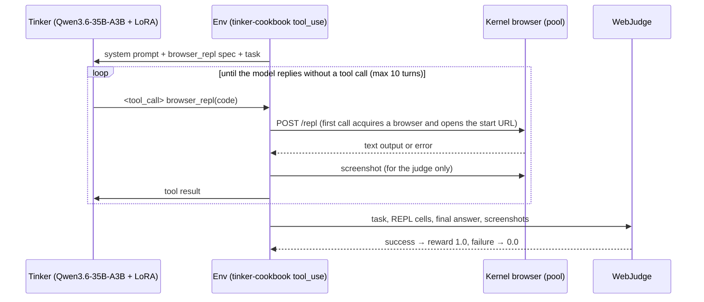

# Browser Agent RL with Kernel + Tinker

Train a small text model to drive a real browser with reinforcement learning.

The agent has exactly one tool: `browser_repl`, which runs JavaScript in the [Kernel Browser REPL](https://github.com/kernel/kernel-images/blob/main/server/docs/repl.md), a persistent Node.js runtime attached to a cloud browser with helpers such as `gotoUrl`, `click`, `fillInput`, `accessibilitySnapshot`, and `js`. The model reads pages as text (accessibility snapshots, DOM queries) and acts by writing code. GRPO on [Tinker](https://tinker-docs.thinkingmachines.ai/) teaches it to use that tool well.

**Key technologies:**

- [**Kernel**](https://www.kernel.sh/docs) — cloud browsers, browser pools, and the Browser REPL
- [**Tinker**](https://tinker-docs.thinkingmachines.ai/) + [**tinker-cookbook**](https://github.com/thinking-machines-lab/tinker-cookbook) — LoRA RL training and sampling; the cookbook's `tool_use` library runs the multi-turn tool loop
- [**WebJudge**](https://github.com/OSU-NLP-Group/Online-Mind2Web) — LLM-as-judge reward from the [Online-Mind2Web benchmark](https://arxiv.org/abs/2504.01382)

The default policy is `Qwen/Qwen3.6-35B-A3B` with thinking disabled: a mixture-of-experts model with 3B active parameters, so sampling is fast and cheap. Any Tinker model with a tool-calling renderer works (`model_name=...`); list them with `tinker.ServiceClient().get_server_capabilities()`.

| Policy (agent_auth, first 20 eval-split tasks, 1 rollout each) | Baseline success |
| --- | --- |
| `Qwen/Qwen3.6-35B-A3B` | 6/20 (30%) |
| `Qwen/Qwen3.5-4B` | 1/20 (5%) |

GRPO learns only from groups with mixed outcomes, so a ~30% baseline is a good starting point; at 5% almost every group scores all zeros.

---

## Quick Start

### 1. Install

```bash
git clone https://github.com/kernel/kernel-tinker-rl.git
cd kernel-tinker-rl
uv sync
```

### 2. Set API keys

Create `.env` in the project root:

```bash
KERNEL_API_KEY=...       # https://www.kernel.sh
TINKER_API_KEY=...       # https://thinkingmachines.ai/tinker
OPENROUTER_API_KEY=...   # WebJudge (openai/gpt-5-mini by default)
WANDB_API_KEY=...        # optional
```

### 3. Create a browser pool

Each rollout uses its own pooled browser, so a training step needs `batch_size × group_size` browsers (64 with the defaults). The idle timeout must cover the longest gap between tool calls; REPL calls keep a browser alive.

```bash
brew install onkernel/tap/kernel
kernel browser-pools create --name rl-training --size 64 --timeout 300
```

### 4. Run the agent on one task

```bash
uv run python -m scripts.evaluate \
    url=https://github.com \
    task="Find the sign in page and list its input fields" \
    pool_name=rl-training \
    verbose=True
```

`verbose=True` prints every REPL cell the model wrote, its output, the final answer, and WebJudge's reasoning.

### 5. Split the dataset

```bash
uv run python scripts/split_dataset.py examples/agent_auth/tasks.jsonl
# -> examples/agent_auth/tasks_train.jsonl (375) and tasks_eval.jsonl (94)
```

### 6. Measure the baseline

```bash
uv run python -m scripts.evaluate \
    env=agent_auth \
    task_file=examples/agent_auth/tasks_eval.jsonl \
    pool_name=rl-training \
    output=results/baseline_eval.json
```

### 7. Train

```bash
uv run python -m scripts.train \
    env=agent_auth \
    task_file=examples/agent_auth/tasks_train.jsonl \
    eval_task_file=examples/agent_auth/tasks_eval.jsonl \
    pool_name=rl-training \
    wandb_project=browser-repl-rl
```

Logs, metrics, and `checkpoints.jsonl` go to `results/<run_name>/`. The learning rate defaults to `hyperparam_utils.get_lr(model_name)`. Every field of `CLIConfig` in `scripts/train.py` can be overridden as `key=value`.

### 8. Evaluate the trained model

```bash
uv run python -m scripts.evaluate \
    env=agent_auth \
    task_file=examples/agent_auth/tasks_eval.jsonl \
    model_path=tinker://<run-id>/sampler_weights/<name> \
    pool_name=rl-training \
    output=results/trained_eval.json
```

Use a `sampler_path` from `checkpoints.jsonl`. Plot the reward curve with `uv run python -m scripts.plot_metrics results/`.

---

## How It Works



1. **One tool.** `core/repl_tool.py` exposes `browser_repl(code)`. Its description is the REPL's semantics plus the generated method reference vendored from kernel-images (`core/repl_reference.md`). Refresh it with `uv run python -m scripts.sync_repl_docs`.
2. **Text in, code out.** The model never sees pixels. It prints what it needs (`repl.write(...)`), and outputs over 4,000 characters are truncated, so filtering snapshots is part of what it learns.
3. **Episode end.** The model's first reply without a tool call is its final answer. Episodes also end at 10 turns or 32K trajectory tokens.
4. **Reward.** WebJudge scores the trajectory: key points from the task, relevance scores for the screenshots captured after each REPL call, then a success/failure verdict that also checks the final answer. The model is text-only; the judge is a VLM.
5. **GRPO.** Tinker runs `group_size` rollouts per task and reinforces the ones that beat the group mean. Rollouts use the cookbook's `agentic()` preset: sequential tool calls, up to 2 retries for malformed tool calls, and no positive reward for episodes that hit a limit.

### Why the REPL instead of screenshots and clicks?

- **Small models can do it.** Reading an accessibility snapshot and writing `await click(node)` is a text task, so a model with 3B active parameters starts at a useful success rate without any vision input.
- **One tool, lots of room to improve.** The base model makes the mistakes you would expect: forgetting to print results, `await accessibilitySnapshot().nodes` precedence bugs, dumping a whole snapshot into context, or announcing a click instead of doing it. Each one is visible in the transcript and fixable by RL.
- **The same tool agents use in production.** The REPL is the same API exposed by the Kernel CLI (`kernel browsers repl`), SDKs, and MCP server.

---

## Project Structure

```
kernel-tinker-rl/
├── core/
│   ├── repl_tool.py          # browser_repl tool (Tinker Tool protocol over the Kernel REPL)
│   ├── repl_reference.md     # vendored REPL method reference (scripts/sync_repl_docs.py)
│   ├── env.py                # Env group builder, dataset builder, WebJudge reward
│   └── reward_models/        # WebJudge
├── examples/
│   ├── agent_auth/           # find login/sign-up pages and report their input fields (470 tasks)
│   └── web_nav/              # generic navigation tasks (10 tasks)
├── scripts/
│   ├── train.py              # GRPO training
│   ├── evaluate.py           # run + judge on a task file or one ad-hoc task
│   ├── sync_repl_docs.py     # refresh core/repl_reference.md from kernel-images
│   ├── split_dataset.py      # train/eval split
│   └── plot_metrics.py       # reward curves from metrics.jsonl
└── docs/
    ├── architecture.md
    └── custom-environments.md
```

## Task Format

```json
{"id": "github-sign-in", "initial_url": "https://github.com", "task": "Navigate to github.com and find the sign in page..."}
```

To add your own use case, see [docs/custom-environments.md](docs/custom-environments.md).

## Exporting Trained Weights

Tinker checkpoints can be sampled directly with `model_path=tinker://...`. To serve elsewhere, download and convert them with the cookbook's [`weights`](https://github.com/thinking-machines-lab/tinker-cookbook/tree/main/tinker_cookbook/weights) module (`weights.download`, then `build_hf_model` to merge or `build_lora_adapter` for vLLM/SGLang).

---

## References

- [Kernel Browser REPL docs](https://github.com/kernel/kernel-images/blob/main/server/docs/repl.md)
- [Tinker docs](https://tinker-docs.thinkingmachines.ai/) and [tinker-cookbook](https://github.com/thinking-machines-lab/tinker-cookbook) (see `recipes/search_tool` and `recipes/harbor_rl` for related tool-use RL recipes)
- [Online-Mind2Web: Evaluating Web Agents with Realistic Interaction](https://arxiv.org/abs/2504.01382)
- [GRPO: Group Relative Policy Optimization](https://arxiv.org/abs/2402.03300)

## License

MIT
