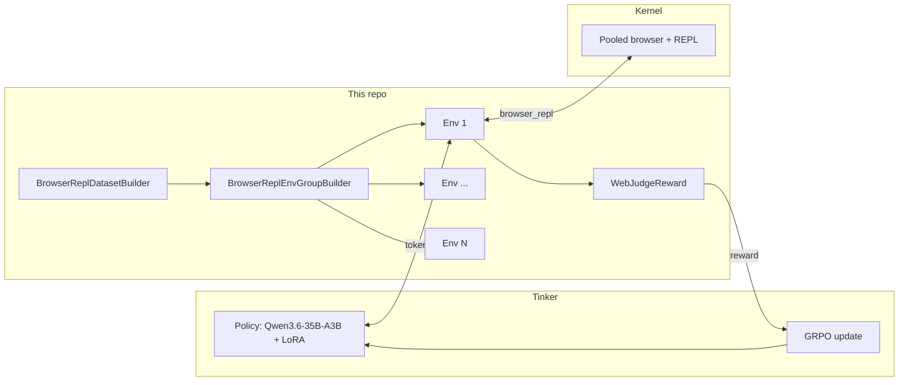

# Architecture

How a task becomes a gradient update.

## Components

### `core/repl_tool.py` — the tool

`BrowserReplTool` implements tinker-cookbook's `Tool` protocol (`name`, `description`, `parameters_schema`, `run`, `to_spec`).

- **Spec:** one required string parameter, `code`. The description combines short REPL semantics (persistence, printing, `js()` scoping, truncation) with `core/repl_reference.md`, the method reference generated in kernel-images. WebMCP methods are left out by default to keep the prompt small (`scripts/sync_repl_docs.py --include-webmcp` to add them).
- **Browser lifecycle:** the first `run()` acquires a browser from the pool, resets the REPL, and opens the task's start URL in a fresh browser context. Pools return browsers as the last occupant left them, so setup disposes every older context and clears the default context's cookies and extra tabs. `release()` returns the browser with `reuse=True`, or `reuse=False` if setup failed or the session was lost (HTTP 404/410). Acquisition is lazy because cookbook retry strategies call `make_envs()` again and use only one of the new envs; its SDK HTTP timeout is kept longer than the pool's long-poll timeout so queued rollouts can wait safely.
- **Output:** text items are joined, image items are replaced with a placeholder, errors are appended as `Error: ...`, and the result is capped at 4,000 characters.
- **Judge evidence:** after every call the tool captures a screenshot with `browsers.computer.capture_screenshot` and records the cell (`ReplCall`). The policy never sees these screenshots.

### `core/env.py` — environment and dataset

- `BrowserReplEnvGroupBuilder.make_envs()` builds `group_size` envs with `tinker_cookbook.tool_use.build_agent_tool_env`. Each env gets its own `BrowserReplTool` and `WebJudgeReward`, and the conversation starts with the renderer's tool-declaration prefix, the env's system prompt, and the task. `cleanup()` releases every browser the group acquired. Prompt rendering shares a tokenizer, so tokenizer calls are serialized across the cookbook's worker threads to avoid concurrent mutation of Transformers fast-tokenizer state.
- `make_rollout_config()` starts from the cookbook's `agentic()` preset and overrides the limits: `max_turns` turns and tool calls, and `max_trajectory_tokens`. The preset runs tool calls sequentially, retries malformed tool calls up to twice with a corrective message, and clamps rewards to ≤ 0 for episodes stopped by a limit. `scripts/train.py` passes the same termination policy to `train.Config`.
- `BrowserReplDatasetBuilder` is the `RLDatasetBuilder` that `train.main` calls. It returns a shuffled train dataset and, when `eval_task_file` is set, a test dataset that the trainer evaluates every `eval_every` steps.

### `WebJudgeReward` — the reward

Called once per episode at the end with the message history. An episode with no `browser_repl` calls gets 0.0 without judging. Otherwise it takes the final assistant message as the answer and builds a WebJudge `Trajectory`:

- `action_history`: each REPL cell (truncated to 1,000 chars) followed by `Final answer: ...`
- `screenshots`: one per REPL call, downscaled to 1280px

WebJudge (`core/reward_models/webjudge.py`, ported from Online-Mind2Web) then:

1. extracts key points from the task,
2. scores each screenshot 1–5 for relevance,
3. judges success against the env's evaluation criteria, using the high-scoring screenshots.

Reward is 1.0 on success, 0.0 otherwise. Metrics logged per episode: `webjudge_success`, `repl_calls`, `repl_errors`.

## Training loop

`scripts/train.py` builds a `tinker_cookbook.rl.train.Config` and calls `train.main`. Each step:

1. Take `batch_size` tasks; for each, run `group_size` rollouts concurrently against the current sampler weights.
2. Compute group-relative advantages (reward minus group mean). Groups with identical rewards contribute no gradient. Watch `env/all/by_group/frac_mixed`.
3. Apply an `importance_sampling` policy-gradient update to the LoRA adapter.
4. Every `save_every` steps, save sampler weights (paths in `results/<run>/checkpoints.jsonl`).

`rollout_error_tolerance=True` retries rollouts that raise (e.g. a site that fails to load) instead of failing the step.

## Useful metrics

| Metric | Meaning |
| --- | --- |
| `env/all/reward/total` | Mean reward (WebJudge success rate, minus parse-error penalties) |
| `env/all/webjudge_success` | Judge success rate |
| `env/all/repl_calls`, `env/all/repl_errors` | Tool calls and failed cells per episode |
| `env/all/stop/*` | Why episodes ended: `completed`, `max_turns`, `parse_error`, ... |
| `env/all/by_group/frac_mixed` | Fraction of groups with a learning signal |
